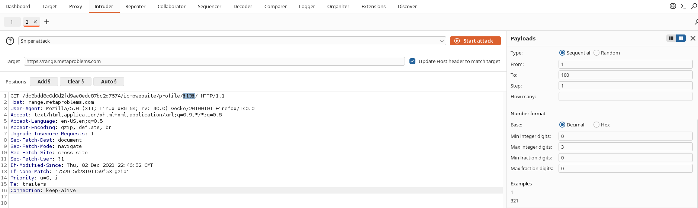
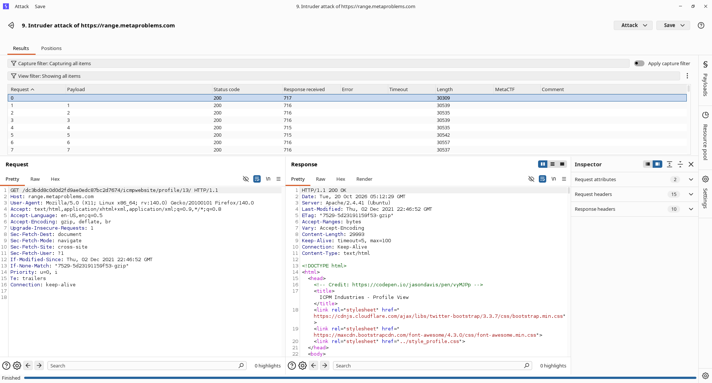

## [Very Public Profiles](https://app.skillbit.com/challenges/312)

**Platform:** MetaCTF

**Category:** Web Exploitation

**Subcategory:** Insecure Direct Object Reference

## Statement

> ICMP Industries' website has a nice feature that allows you to view your profile, just by going to the website. In fact, you can see your profile by visiting [here](https://range.metaproblems.com/dc3bdd8c0d0d2fd9ae0edc87bc2d7674/icmpwebsite/profile/13). Taking a closer look at the URL though, it almost seems as if you might can see other people's profiles...

## Initial Understanding

This is clearly a case of IDOR, where changing the profile ID leads to accessing other people's profiles.

## Attempt 1

- Sent the request of profile pages to BurpSuite intruder and filtered by MetaCTF, hoping one request page will have our flag.

- None of them contained MetaCTF.

## Attempt 2 (What worked)

- Manually visited every available profile using IDOR.
- One of the profiles had this username: `you_are_now_a_1337_url_h4x0r`

### That is our flag: `MetaCTF{you_are_now_a_1337_url_h4x0r}`
